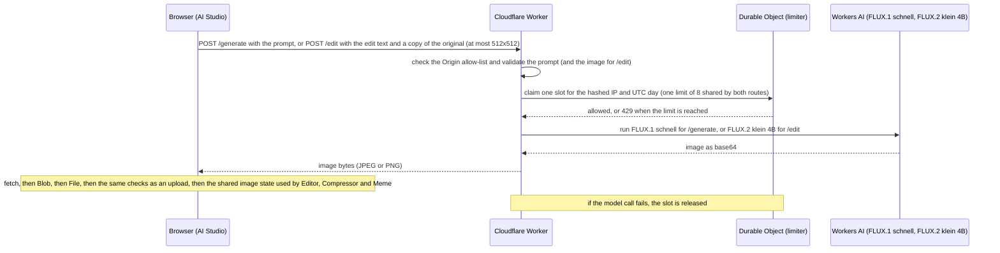

# PixelKit

A guest-only photo toolkit that runs in your browser: edit, compress, caption, design and generate images without an account.

Live: https://pixelkit-wheat.vercel.app

## Features

- **Editor**: brightness, contrast, blur, grayscale and invert, plus rotate, flip, crop, resize and a text overlay, with Undo, reset and export.
- **Compressor**: quality slider, JPG, PNG or WebP (where the browser supports it), before and after file size, download.
- **Meme / Post**: top and bottom text, font, colour and size, with Instagram post, Instagram portrait and WhatsApp Status sizes.
- **Logo Maker**: text, rectangles and circles that you drag, order in layers and export as a 1000 x 1000 PNG, with a transparent or solid background.
- **Catalog**: free photos from Picsum with infinite scroll; "Use this image" opens one in the Editor.
- **AI Studio**: describe an image (up to 300 characters) and a Cloudflare Worker generates it with Workers AI (FLUX.1 schnell, route `/generate`). Then describe changes in words ("make the shirt red") and the Worker edits it with FLUX.2 klein 4B (route `/edit`), always starting from the original, with Reset to original. Both routes share one daily limit of 8 images per IP. Download the result or open it in the Editor, Compressor or Meme.

There is no login and no backend for your photos. Image processing runs in the browser, and photos you upload never leave your device. The exceptions are Catalog photos, which are downloaded from Picsum, and AI Studio, which sends your prompt text to the Worker. For an AI edit, a downscaled copy (at most 512x512) of the image AI Studio generated is also sent to the Worker and Workers AI; your own photos are never sent. Your work is saved automatically in the browser. Recents lists your newest 10 projects, and you can resume, rename or delete them.

## Tech stack

- Vanilla HTML, CSS and JavaScript (ES modules). No framework, no build step and no external JavaScript dependencies. Only the fonts come from Google Fonts.
- Canvas for drawing and export; IndexedDB for original images and localStorage for project metadata (Recents).
- Hosting: Vercel (static files).
- AI feature: a Cloudflare Worker (`worker/`) that calls Workers AI (FLUX.1 schnell for `/generate`, FLUX.2 klein 4B for `/edit`) and uses a Durable Object for a per-IP daily limit.

## AI Studio architecture



The browser fetches the response as a Blob, so the image is local data and never taints a canvas. It then goes through the same file checks as an upload before it becomes the shared image.

## Engineering decisions

- **State drives the UI.** One state object; handlers change it and render functions draw from it. The DOM is never the source of truth.
- **Dependencies point one way.** Tools use `core/` helpers and never import each other; `core/` never imports a tool.
- **A Worker instead of calling an AI API from the browser.** Any key placed in client code can be read by every visitor. The Worker reaches Workers AI through a binding, so no secret exists in the repository or in the browser.
- **The image service sits behind one function.** The browser code that talks to the service is `requestImage` in `js/tools/ai.js`. The first free image provider's current API started requiring a key, and its older keyless endpoint blocked browser requests with a human check (Cloudflare Turnstile). Only `requestImage()` had to change when I moved to my own Cloudflare Worker.
- **Per-IP daily limit.** Each IP may generate 8 images per UTC day (`DAILY_LIMIT` in `worker/src/index.js`). A SQLite-backed Durable Object checks and counts in one synchronous step before the model is called, so two simultaneous requests cannot both take the last slot. A failed model call gives the slot back. Only a SHA-256 hash of the IP and the date are stored (the hash is not salted), and rows of earlier days are deleted. If the Durable Object fails, the request goes through and the error is logged. This is a deliberate choice of availability over protection.
- **Worker origin allow-list.** The Worker answers only requests whose `Origin` is the live site or `http://localhost:8000`, and accepts only a prompt of 1 to 300 characters. The model and its settings are fixed on the server.
- **Uploads are checked by content.** JPG, PNG and WebP only, verified by MIME type and file signature (magic bytes), with 10 MB and 40 megapixel limits. SVG is rejected.
- **Strict Content Security Policy.** No inline scripts, no `unsafe-*`. User and network text is set with `textContent`.
- **One shared logger.** All console logs go through `js/core/logger.js`; frequent events are logged once the user pauses. Image data and typed text are never logged.
- **Storage split.** Original images are kept in IndexedDB and small project metadata in localStorage. Stored data is validated when it is loaded.

More detail: [docs/ARCHITECTURE.md](docs/ARCHITECTURE.md) and [docs/PRD.md](docs/PRD.md).

## Known limitations

- The Worker uses the Workers Free plan, and its daily AI quota is shared by all visitors. When it is used up, generation fails until 00:00 UTC.
- The origin check only stops browsers on other sites. A script can send a fake `Origin` header, so the per-IP limit only reduces abuse. It does not stop someone with many IP addresses, and people who share an IP address share its 8 images.
- An AI edit uses roughly twice as much free quota as a generation (an estimate from the Workers AI pricing page), and the edited background is similar but redrawn, not pixel-identical.
- Autosave waits 1 second after the last change. If a new image loads less than 1 second after an edit, that last edit can be lost; the project and its image survive. See [docs/ARCHITECTURE.md](docs/ARCHITECTURE.md) for the proposed fix.
- No testing on real devices or in real Safari yet.
- Meme settings and logos are not saved with a project.
- Compress and export are slow on very large photos (4000px and above).
- Delete uses the browser's plain confirm dialog.
- Meme uses centre crop only. Impact font may fall back on some Android and Linux devices.
- Recents keeps the newest 10 projects; older ones are deleted automatically.
- A WebP photo is exported from the Editor as JPG.
- The Meme preview shows transparent areas dark, but the JPG export fills them white.
- Undo works only in the Editor and is not saved with the project.
- Compressor and Meme use the original photo, without the Editor's filters, rotation, flips, crop, resize and text.
- Crop uses four sliders (no drag handles). If you rotate after cropping, the same trims apply to the new edges.
- Resize only shrinks, and only the exported file changes size; the preview keeps its size.
- The text overlay is one line in a fixed font (Arial bold). It is placed with sliders, not by dragging, and it is not wrapped.

## Run locally

```
python -m http.server 8000
```

Then open http://localhost:8000. Use port 8000: the Worker's CORS allows only `http://localhost:8000`, so AI Studio does not work on another port. Opening the HTML file directly does not work either, because browsers block ES modules loaded from `file://`.

Local pages call the deployed Worker, so nothing else needs to be installed or configured. To deploy your own copy of the Worker, see the "AI Worker" section in [docs/ARCHITECTURE.md](docs/ARCHITECTURE.md).

## Testing

The repository has no automated tests. The app was checked by hand, with ad hoc Playwright scripts for the browser steps (the scripts are not part of the repository):

- **Functional**: every control of the six tools, and every export format and size.
- **Integration**: image sharing between Editor, Compressor, Meme and AI Studio; Recents after a page reload; AI Studio against the deployed Worker.
- **Edge cases**: very large and tiny images, wrong file types, corrupt files, EXIF rotation, empty and long prompts, prompts with HTML characters, double clicks, and switching tools during a request.
- **Accessibility**: keyboard-only use, visible focus, labels, alt text, contrast and live regions, checked with scripts. No screen reader was used.
- **Responsive**: 320, 390, 768 and 1280 pixels wide, with no sideways scroll.
- **Browsers**: Chromium in full; Firefox and WebKit through Playwright as a short smoke test.
- **Worker limiter**: its logic was run locally against a stubbed AI and a real SQLite database (limit reached, new UTC day, released slot, simultaneous requests, fail open). It is not part of the repository. The deployed Worker was checked with two real generations from the live site.
