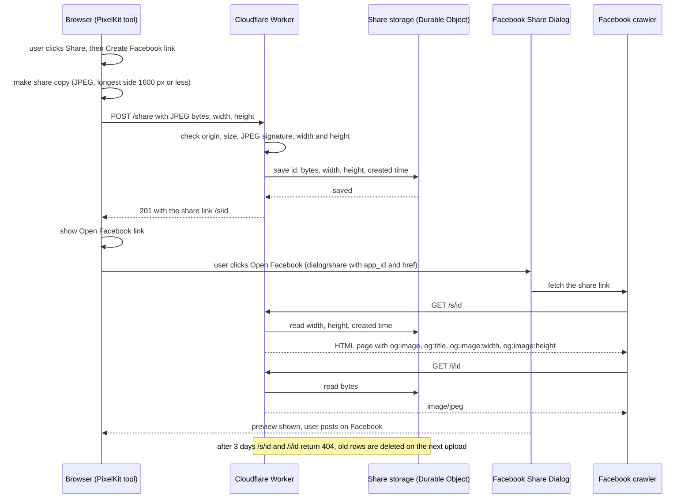

# Share on Facebook: research and design

Status: built, with changes from this proposal: links last 7 days (not 3), Facebook is opened with `sharer.php`, the upload is a multipart form, and the copy is padded to at least 200x200. `docs/ARCHITECTURE.md` describes what was built.
Date of research: 2026-11-05. Every platform fact below links to the official page it came from. Facts I could not confirm are listed at the end, not guessed.

## 1. Goal and non-goals

Goal: from any tool (Editor, Compressor, Meme, Logo Maker, AI Studio), the user can post the image they just made to their own Facebook account, on laptop and phone browsers, with no login in PixelKit.

Non-goals:

- No PixelKit accounts, no Facebook Login inside PixelKit, no Facebook SDK.
- No posting through the Graph API. It is not possible for a normal app (see 2.1).
- No gallery, no listing of shared images, no early delete, no edit after sharing.
- No other networks in this change (the phone share sheet covers them for free, see 6.3).
- No security hardening beyond what the current Worker already does (per the brief). Cost and privacy are covered honestly.

Conflict with the current product docs: `docs/PRD.md` lists "No accounts, sync or sharing" and "there is no user content store" as non-goals, and says "Your images stay on the device and are never uploaded". This feature changes all three. The PRD, README and ARCHITECTURE must be updated in the same change (wording in section 7).

## 2. Verified platform facts

### 2.1 Facebook

| Fact | Source |
|---|---|
| The documented way to share a link from a website is the Share Button plugin or the Share Dialog. Neither needs Facebook Login or App Review: "you do not need to implement Facebook login or request any additional permissions through app review". | [Sharing on the web](https://developers.facebook.com/docs/sharing/web), [Share Button](https://developers.facebook.com/docs/plugins/share-button) |
| Share Dialog URL: `https://www.facebook.com/dialog/share?app_id=...&display=...&href=...&redirect_uri=...`. `app_id` is listed as required ("Yes. Provided automatically when you use the SDK."). `redirect_uri` is marked Deprecated but still listed as required. For URL redirection `display` is `page`; on mobile web it is "always `touch`". | [Share Dialog reference](https://developers.facebook.com/docs/sharing/reference/share-dialog) |
| `sharer.php` is not mentioned on any current Meta sharing page I read (web sharing, Share Dialog reference, Share Button). It is undocumented. | same three pages |
| The preview comes from Open Graph tags: `og:url`, `og:title`, `og:description`, `og:image`; `og:type` defaults to `website`. `fb:app_id` is only needed for Insights. | [Sharing for Webmasters](https://developers.facebook.com/docs/sharing/webmasters) |
| `og:image:type` is "One of `image/jpeg`, `image/gif` or `image/png`". WebP is not listed. | [Sharing for Webmasters](https://developers.facebook.com/docs/sharing/webmasters) |
| Image rules: minimum 200 x 200; at least 600 x 315 for the large card; "at least 1200 x 630 pixels" recommended; ratio "as close to 1.91:1 as possible"; "must not exceed 8 MB". | [Images in link shares](https://developers.facebook.com/docs/sharing/webmasters/images) |
| Caching: the crawler caches when a URL is first shared and "has to see an image at least once before it can be rendered", so the first sharer may see no image. Fixes: Sharing Debugger, a Graph API scrape, or `og:image:width` and `og:image:height`. Images are cached by URL. "Don't remove old images", because older posts may still point to them. Normal refresh period is 24 hours. | [Images in link shares](https://developers.facebook.com/docs/sharing/webmasters/images), [Best practices](https://developers.facebook.com/docs/sharing/best-practices) |
| Sharing Debugger (`https://developers.facebook.com/tools/debug/`) shows the tags the crawler read and any errors, and "also triggers a scrape". It is a developer tool, not part of the user flow. | [Sharing for Webmasters](https://developers.facebook.com/docs/sharing/webmasters) |
| Crawler: user agent `facebookexternalhit/1.1`; tags must be in the first 1 MB; the page must be crawlable "within a few seconds"; the server must support gzip and deflate; a `Range` header may be ignored. | [Web crawlers](https://developers.facebook.com/docs/sharing/webmasters/web-crawlers) |
| Posting to a user's own timeline through the API is not available: `/user/feed` says for Creating "You can't perform this operation on this endpoint". The current permissions list has no `publish_actions` and no permission for general posts to a personal profile (only `publish_video` for live video, and Page/Group permissions). | [User feed reference](https://developers.facebook.com/docs/graph-api/reference/user/feed), [Permissions](https://developers.facebook.com/docs/permissions) |

What this means: the user's post is a link card (our preview image, a title, our domain), not a native photo upload. Facebook crops the preview toward 1.91:1.

### 2.2 Cloudflare storage (Workers Free plan)

| | R2 | Workers KV | Durable Object (SQLite) |
|---|---|---|---|
| Free allowance | 10 GB-month storage, 1 M Class A (writes) and 10 M Class B (reads) per month, egress free | 1,000 writes, 100,000 reads, 1,000 deletes per day, 1 GB stored | 100,000 requests, 100,000 rows written, 5 M rows read per day, 5 GB stored per account |
| Above the free allowance | billed ($0.015 per GB-month, $4.50 per M Class A, $0.36 per M Class B) | that operation fails until 00:00 UTC | that operation fails until 00:00 UTC |
| Payment method | needs "an R2 subscription" through a "checkout flow" (see section 11) | no, part of Workers Free | no, already in use for `RateLimiter` |
| Largest object | not limiting here | 25 MiB value, 1024 bytes metadata | 2 MB per BLOB or row |
| Automatic expiry | lifecycle rule in days, objects "typically removed within 24 hours" after expiry | `expirationTtl` (minimum 60 s), deleted automatically | none built in: delete old rows in code, or an alarm |
| Read after write | "Strongly consistent ... immediately ... globally" | "eventually-consistent": "up to 60 seconds or more" elsewhere, and "Negative lookups ... are also cached" | strongly consistent (one instance) |
| Worker binding | `r2_buckets` | `kv_namespaces` | `durable_objects` (exists) |
| Public access | r2.dev URL ("rate-limited", "non-production") or a custom domain on a Cloudflare zone; or serve through the Worker | through the Worker only | through the Worker only |

Sources: [R2 pricing](https://developers.cloudflare.com/r2/pricing/), [R2 get started](https://developers.cloudflare.com/r2/get-started/), [R2 lifecycles](https://developers.cloudflare.com/r2/buckets/object-lifecycles/), [R2 public buckets](https://developers.cloudflare.com/r2/buckets/public-buckets/), [R2 Workers API](https://developers.cloudflare.com/r2/api/workers/workers-api-usage/), [R2 consistency](https://developers.cloudflare.com/r2/reference/consistency/), [KV limits](https://developers.cloudflare.com/kv/platform/limits/), [KV pricing](https://developers.cloudflare.com/kv/platform/pricing/), [KV write](https://developers.cloudflare.com/kv/api/write-key-value-pairs/), [How KV works](https://developers.cloudflare.com/kv/concepts/how-kv-works/), [DO limits](https://developers.cloudflare.com/durable-objects/platform/limits/), [DO pricing](https://developers.cloudflare.com/durable-objects/platform/pricing/), [Workers pricing](https://developers.cloudflare.com/workers/platform/pricing/).

### 2.3 Worker limits (Free plan)

| Limit | Value | Source |
|---|---|---|
| Requests | 100,000 per day; above it, Error 1027 until midnight UTC | [Workers limits](https://developers.cloudflare.com/workers/platform/limits/) |
| CPU time per HTTP request | 10 ms | same |
| Memory | 128 MB per isolate | same |
| Request body | 100 MB on a Free Cloudflare plan (413 above) | same |
| Subrequests | 50 per request | same |

### 2.4 Web Share API (phone fallback)

`navigator.share({ files })` needs HTTPS and a user click ("transient activation"); check first with `navigator.canShare({ files })`. Errors: `AbortError` (user cancelled), `NotAllowedError`, `TypeError` (files not supported), `DataError`. Sources: [MDN navigator.share](https://developer.mozilla.org/en-US/docs/Web/API/Navigator/share). Support: Chrome, Edge, Safari (macOS and iOS), Chrome Android, Samsung Internet yes; Firefox desktop no ([caniuse](https://caniuse.com/web-share)). `vercel.json` sets a Permissions-Policy that does not mention `web-share`, so the default (same origin allowed) applies.

## 3. User flow

1. The user finishes an image in any tool and clicks **Share**.
2. A small dialog opens with the privacy note (section 7) and two buttons: **Create Facebook link** and, only where `navigator.canShare({ files })` is true, **Share with an app**.
3. **Create Facebook link**: the browser makes a share copy (JPEG, longest side at most 1600 px, white background), uploads it to the Worker, and gets back a link.
4. The dialog shows **Open Facebook**, a normal link (`target="_blank"`) to the Share Dialog with our link as `href`. Because the user clicks a real link, popup blockers do not apply.
5. Facebook opens. If needed, the user logs in to Facebook (in Facebook, not in PixelKit). The Facebook crawler fetches our share page and image and shows the preview.
6. The user writes a message, chooses the audience and posts. PixelKit is not told whether they posted.
7. After 3 days the share page and image return "expired". Facebook may still show its own cached preview.

Phone path: **Share with an app** opens the phone's share sheet with the image file itself. If the Facebook app is installed it can be picked there and the image is posted as a photo. Nothing is uploaded to PixelKit on this path.

## 4. Sequence diagram

## 5. Storage options and recommendation

**Option A: Durable Object with SQLite (recommended).** A new class `ShareStore`, one instance, one table `shares (id, bytes BLOB, width, height, created)`.
- For: no payment method and no bill (free limits fail, they do not charge); strongly consistent, so the crawler always finds a fresh upload; the page route reads only `width, height, created`, not the image; same pattern and migration style as `RateLimiter`, so nothing new to learn.
- Against: no built-in expiry, so the Worker deletes rows older than 3 days on each upload and refuses to serve them on read; 2 MB per BLOB; one instance in one location (some latency for far users); the free per-object storage is stated as both 10 GB and 1 GB in Cloudflare's docs, so plan for 1 GB.
- Cost: $0. Capacity at about 400 KB per copy and 3-day expiry: roughly 2,500 live images in 1 GB, so about 800 shares per day.

**Option B: R2.**
- For: built for files, lifecycle rule for expiry, strongly consistent, 10 GB free, scales far beyond our needs.
- Against: needs an R2 subscription through a checkout flow (very likely a card, see section 11); usage above the free tier is billed, so abuse costs real money; lifecycle deletion can lag up to 24 hours (we still check age on read); a new product to set up.
- Cost: $0 within the free tier, then usage-based.

**Option C: Workers KV.**
- For: smallest API, exact expiry with `expirationTtl`, no card, no bill.
- Against: eventual consistency. A write can take "60 seconds or more" to appear in other locations and "not found" is cached. The crawler fetches right after upload, often from another region, so the first scrape can miss and Facebook caches a card without an image for that link. Also only 1,000 writes per day.
- Cost: $0.

Recommendation: **Option A**. It is free with hard limits, it is consistent when the crawler arrives, and it reuses what the Worker already does. Move to R2 only if sharing outgrows about 800 per day, accepting a card on file and a budget alert.

## 6. Design

### 6.1 Worker routes (in `worker/src/index.js`)

The current `fetch` returns 403 when `Origin` is not ours. The crawler and people opening a link send no `Origin`, so the two GET routes are matched **before** the origin check. `POST /share` stays behind it and reuses `corsHeaders`.

| Route | Who calls it | Does |
|---|---|---|
| `POST /share?w=W&h=H` | PixelKit page | Body is the raw JPEG (`Content-Type: image/jpeg`). Checks: origin, `Content-Length` and real length at most `MAX_SHARE_IMAGE` (1.5 MB, under the 2 MB BLOB limit and far under Facebook's 8 MB), JPEG signature (reuse `detectType`), `w` and `h` integers from 1 to 1600. Optional per-IP limit (6.4). Saves with `id = crypto.randomUUID()`. Answers `201 { "url": "https://pixelkit-ai.hashir-dev.workers.dev/s/<id>" }`. |
| `GET /s/<id>` | Facebook crawler, anyone with the link | Validates the id format, reads `width, height, created`. Missing or older than 3 days: 404 HTML "This shared image has expired" with a link to PixelKit. Otherwise a small HTML page (below). |
| `GET /i/<id>` | Facebook crawler, the share page | Same checks, returns the bytes with `Content-Type: image/jpeg`, `X-Content-Type-Options: nosniff`, `Cache-Control: public, max-age=86400`. |

A raw body instead of a form keeps Worker CPU low (no multipart parsing within the 10 ms budget). It causes one CORS preflight, which the existing `OPTIONS` handling already answers.

Share page content, all fixed text, so no user text is ever written into HTML:

- `og:url` = the share link, `og:type` = `website`, `og:title` = "Made with PixelKit", `og:description` = "Created in the browser with PixelKit, a free photo toolkit.", `og:image` = `https://.../i/<id>`, `og:image:type` = `image/jpeg`, `og:image:width` and `og:image:height` from storage (so the first share shows the image), `og:image:alt` = "Image made with PixelKit".
- Body: the image and a link to `https://pixelkit-wheat.vercel.app`.
- Headers: `Content-Type: text/html; charset=utf-8`, `Content-Security-Policy: default-src 'none'; img-src 'self'`, `X-Robots-Tag: noindex`.

`wrangler.jsonc`: add `ShareStore` to `durable_objects.bindings` (name `SHARES`) and a migration `{ "tag": "v2", "new_sqlite_classes": ["ShareStore"] }`.

### 6.2 Link format and expiry

- Link: `https://pixelkit-ai.hashir-dev.workers.dev/s/<uuid>`; image: `/i/<uuid>`. A random UUID has 122 random bits, so links cannot be guessed, but anyone who has a link can open it.
- Expiry: 3 days from upload, enforced on every read (exact), and old rows are deleted on each new upload (same idea as `RateLimiter` deleting earlier days).
- Facebook's own cached copy is outside our control.

### 6.3 Frontend

One shared module, `js/ui/share.js` (new file; tools may import `ui/`), exporting `openShare(blob)`:

- Opens one shared `<dialog>` in `app.html` (native dialog: focus is kept inside, Escape closes).
- Makes the share copy: decode, draw on a canvas with a white fill (Logo PNGs can be transparent and JPEG has no alpha), longest side at most 1600 px, `canvasToBlob(canvas, "image/jpeg", 0.85)`. This also turns WebP (Compressor) and large PNG exports into a JPEG Facebook accepts. AI Studio already has the same scaling in `shrink()`; the shared version should live in `core/export.js` and `shrink()` should use it (a small refactor that needs approval).
- Uploads with `fetch` (the Worker host is already in `connect-src`, so the CSP does not change), with a timeout like AI Studio's.
- Shows the **Open Facebook** link. Default URL: `https://www.facebook.com/dialog/share?app_id=<APP_ID>&display=page&href=<encoded link>&redirect_uri=<encoded link>`. The app id is public, not a secret.
- **Share with an app**: shown only when `navigator.canShare({ files: [file] })` is true; calls `navigator.share({ files: [file], title: "Made with PixelKit" })` with the original export, not the share copy. `AbortError` is silent; other errors show a message.
- Logs through `logActivity` and `logger`: size in KB and status only, never the image or the link (the link gives access).

One **Share** button per tool, reusing the blob each tool already makes:

| Tool | Blob to pass | Change needed |
|---|---|---|
| AI Studio | `getState().ai.result` | button next to Download |
| Compressor | `compressor.result.blob` | button next to Download |
| Editor | the blob made in `exportImage()` | move the drawing into a function that returns the blob, used by Export and Share |
| Meme | the blob made in `exportMeme()` | same split |
| Logo Maker | the blob made in `exportLogo()` | same split |

### 6.4 Failures

| Failure | Behaviour |
|---|---|
| Offline, timeout, 5xx | Dialog shows "Could not create the link. Check your connection and try again."; nothing is stored; Download still works; on phones **Share with an app** stays available. |
| 400 or 413 (bad or too large) | "This image could not be shared." Should not happen because the browser makes the copy. |
| 429 (per-IP limit, if enabled) | "You have reached today's sharing limit. Try again tomorrow." |
| Storage full or a free daily limit reached | Worker returns 503: "Sharing is not available right now. Try again later." Logged with `console.error`. |
| Facebook cannot fetch the page or image | The post shows a plain link without image. The user cannot fix it; the developer pastes the link into the Sharing Debugger to see why. Width and height tags reduce the "first share has no image" case. |
| Popup blocked | Avoided: Facebook is opened by a real link the user clicks. |
| User closes Facebook without posting | Nothing happens; the link expires on its own. |
| Expired link | 404 page with a link to PixelKit. |

## 7. Privacy

What becomes public: one JPEG copy (at most 1600 px), its width and height, and the upload time. Anyone with the link can view it for 3 days. When the user posts, the link and preview are visible to the Facebook audience the user picks, and Facebook keeps its own copy under Facebook's terms. Nothing else is stored: no IP address, no project name, no file name, no prompt. Cloudflare processes the request as our host. There is no early delete in this version.

Dialog text (shown before upload):

> Sharing to Facebook uploads a copy of this image to PixelKit's server and creates a public link. Anyone with the link can see the image for 3 days, then it is deleted automatically. Facebook keeps its own copy of the preview, and our deletion does not remove your post. Do not share images that contain private information.

Under **Share with an app**: "Shares the image directly from your device. Nothing is uploaded to PixelKit."

README replacement for "photos you upload never leave your device":

> Your photos stay on your device unless you choose **Share**. Creating a Facebook link uploads a copy of the image (JPEG, at most 1600 pixels on the longest side) to our Cloudflare Worker. It is public to anyone with the link and is deleted after 3 days. Facebook makes its own copy when you post. We store no IP address, file name or project name with it. On phones, **Share with an app** sends the image straight from your device without uploading it to us.

PRD: change the non-goal to "No accounts or sync. Sharing stores a public copy for 3 days only when the user asks.", and update the "never uploaded" sentence in Product.

## 8. Quotas and the per-IP limit

Per Facebook share, roughly: 1 upload + 1 preflight + 1 page + 1 to 2 image fetches by the crawler = about 5 Worker requests and 3 to 4 Durable Object requests; each person who later opens the link adds 2 of each. One row written per share (plus one when the limiter is on).

| Free quota | Per day | Rough share capacity | First to run out |
|---|---|---|---|
| Worker requests (shared with AI routes) | 100,000 | about 10,000 shares | no |
| DO requests | 100,000 | about 15,000 shares | no |
| DO rows written | 100,000 | far above need | no |
| DO storage | 1 GB (safe reading) | about 800 shares per day with 3-day expiry | **yes** |

When storage is full, uploads fail with 503 until old rows expire; the AI routes keep working, but the limiter's writes would also fail and it already fails open.

Per-IP limit: the AI limit (8 per day) stays as it is and sharing does not use it. Sharing gets its own counter in the same `RateLimiter` (hash of `"share:" + ip`, suggested 20 per day), so `claim()` takes the limit as a parameter. It follows `LIMIT_ENABLED`, which is `false` today, so with the current setting anyone can fill the storage and turn sharing off for everyone until rows expire. It costs no money with Option A; with R2 it would.

## 9. Size estimate and build order

Rough size: Worker about 90 lines (class 25, routes and page 55, routing 10), `wrangler.jsonc` 2 lines, `js/ui/share.js` about 60 lines, `app.html` about 20 lines (dialog and 5 buttons), CSS about 10 lines, tool changes about 40 lines in total, docs about 30 lines. About 250 lines.

Build order, each step testable on its own:

1. Decide the open questions (section 10). Create the Meta app and note its id.
2. Worker: `ShareStore`, `POST /share`, `GET /s/<id>`, `GET /i/<id>`, the routing change. Test with `npx wrangler dev` and `curl` (upload, page, image, expired, too large, wrong type, no origin).
3. Deploy, then check one link in the Sharing Debugger.
4. Move the scale-to-JPEG helper into `core/export.js` and use it in AI Studio (no behaviour change).
5. `js/ui/share.js`, the dialog, and the AI Studio button. Test the full flow on desktop.
6. Compressor button. Then Editor, Meme and Logo (split export into make-blob and download).
7. **Share with an app**. Test on a real Android phone and a real iPhone.
8. Docs: PRD, README, ARCHITECTURE. Check 320, 390 and 1280 px and 0 console errors.

## 10. Open questions for the reviewer

1. Share Dialog with an app id (documented, needs a free Meta app created by us) or `sharer.php` (no app id, undocumented)?
2. Storage: Option A as recommended, or R2 with a card on file?
3. Expiry: 3 days, or 1 or 7?
4. Share copy size: 1600 px longest side, or keep the full export up to Facebook's 8 MB (would need R2)?
5. Turn on a sharing limit per IP (20 per day) even while the AI limit stays off?
6. Keep links on `pixelkit-ai.hashir-dev.workers.dev`, or add a custom domain?
7. Add a "Copy link" button? Not in this design.

## 11. What I could not verify

- **R2 and a payment method.** The R2 docs say an "R2 subscription" is added through a "checkout flow"; no official page I reached says whether a card is required for the free tier. The billing policy says "Ensure that you are using a valid payment method before ... enabling subscriptions". Treat a card as likely; check in the dashboard.
- **`sharer.php`.** Not mentioned in current Meta docs, so its support status is unknown.
- **Share Dialog details.** The reference contradicts itself (`display=popup` in the example, `page` in the table); `redirect_uri` is deprecated yet "required"; it does not say whether the Meta app must be in Live mode. Needs a real test.
- **Phones.** Whether the dialog link opens the Facebook app or stays in the browser (where the user may have to log in again), and whether the Facebook app appears in the share sheet for an image file on Android and iOS. Needs real devices.
- **Web Share with files per browser.** caniuse does not cover file sharing, and MDN's compatibility table did not load.
- **Facebook after expiry.** Whether existing posts keep the preview image after we delete it (Meta only says "Don't remove old images").
- **workers.dev links on Facebook.** Whether Facebook limits or blocks links on shared hosting domains like `workers.dev`. Not documented.
- **gzip.** Meta requires gzip or deflate; I did not confirm that Cloudflare compresses Worker HTML on `workers.dev` automatically. The page is tiny, so it likely does not matter.
- **CPU time.** Reading a 1.5 MB body and writing it to a Durable Object within the 10 ms Free CPU limit is expected (mostly I/O, not CPU) but not measured.
- **Durable Object storage per object on Free.** The limits page says 10 GB per object in its table and 1 GB on Free in its FAQ. This design assumes 1 GB.
- **Durable Object alarms on Free.** Not stated; the design avoids alarms.
- **When `publish_actions` was removed.** No changelog page I read gives the date. The current docs do confirm that posting to a personal feed is not possible.
